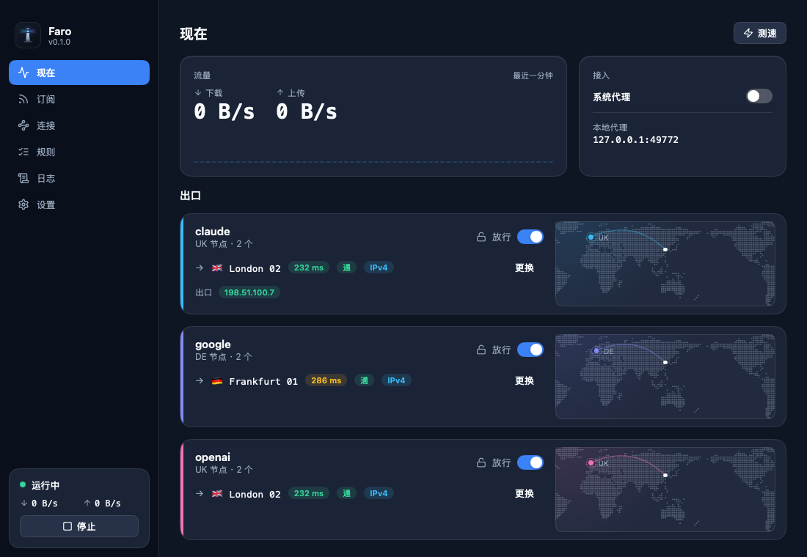
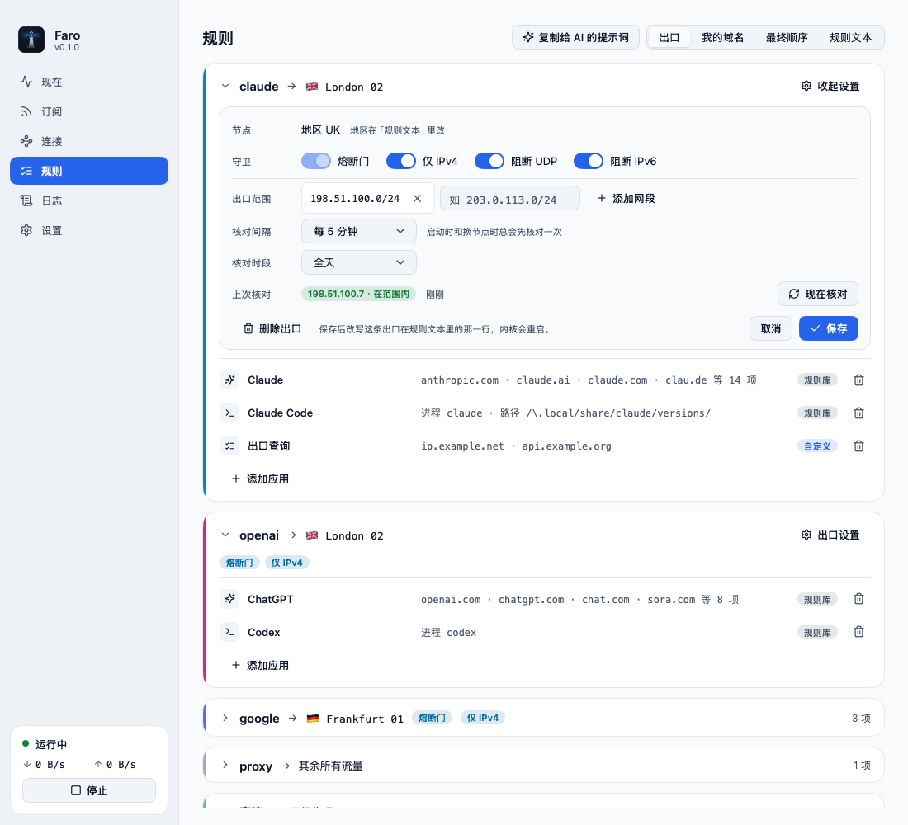
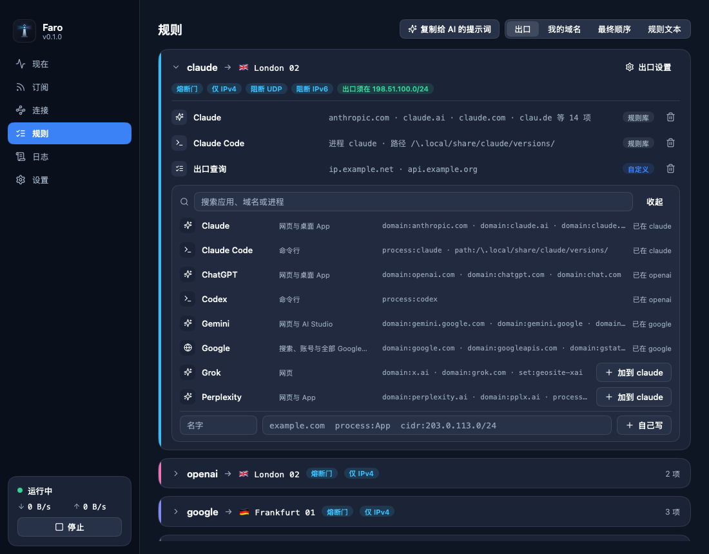
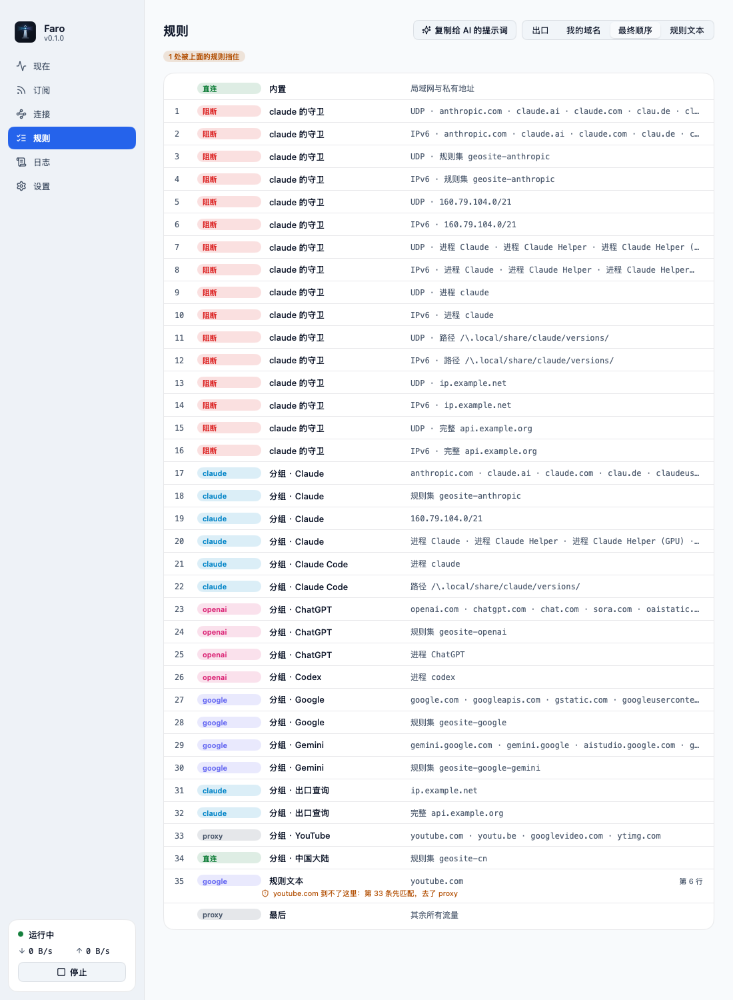

# Faro

**A macOS proxy client for AI accounts.** It keeps accounts like Claude, ChatGPT and Gemini leaving from one fixed, verified exit: no country hopping, no IPv6 or UDP leaks, and the route is cut the moment the exit is wrong.

[简体中文](README.md) · [English](README.en.md)



> The interface is in Chinese for now.

## Why

AI services watch where you connect from: the UK today, Japan tomorrow, a stray request from home now and then, and an account can get flagged. Most proxy clients are built for speed: they pick the fastest node, switch when one fails, and let IPv6 and QUIC go around the proxy. Good for video; the opposite of what an AI account needs.

Faro is built the other way round: **it would rather cut the connection than change the exit.**

- **One service, one exit, one node held.** An exit never moves to a "faster" node on its own; only you change it.
- **Exit check.** Give an exit the ranges it may leave from (`exit:198.51.100.0/24`). Faro asks, through that exit, what address the world sees, on a timer you set, and cuts the exit when it is outside them, with a notification. It always checks at start and when the node changes, and stays cut until the check passes.
- **Gate.** A switch per exit that cuts it at once; while cut, its traffic goes nowhere.
- **No side doors.** With "block UDP" and "block IPv6" on, every rule sent to the exit is repeated as a block **above all other rules**, so QUIC and IPv6 cannot leave another way.
- **No fallback.** An exit with no node, or an application whose exit is gone, is **blocked**, never sent through another country.
- **Desktop apps and command lines too.** Rules match programs and paths as well as names, so the Claude desktop app, Claude Code or Codex are held like a browser is.
- **IPv4-only exits.** Names are looked up here, IPv4 only, through the exit itself, and the node is handed the address.
- **DNS that does not give you away.** Foreign names are looked up through the proxy, domestic ones directly; the system resolver is never used.

## Screenshots

**Exits and their settings.** Cards fold; the node, the guards, the exit ranges and the check's interval and hours are on the card, never inherited.



**The application library.** Search well-known services (Claude, ChatGPT, Gemini, Cursor, GitHub…) and add one to an exit in a click, or write your own from domains, programs or ranges.



**The order.** Every rule as sing-box checks it, top to bottom, with what a rule above takes first marked.



## Also

- Subscriptions and nodes grouped by country; click a node to time it, a red dot when it does not work.
- A map per exit, an arc from this Mac to where it leaves.
- Every connection explains which rule sent it where.
- A small rules language of its own for what applications cannot say, with line-numbered errors.
- A button copies a prompt (the language, your exits and applications) to paste into any AI; Faro sends nothing anywhere itself.
- Community rule sets kept current in the background; a menu bar item; a light mode that keeps only the menu bar (about 20 MB).

## Build

> Early (0.1.0): Apple Silicon, not code-signed, no TUN mode yet. The 0.1.0 build under Releases predates the exits page, applications and exit checks; build from source for those.

macOS and Go 1.27 or newer:

```sh
./scripts/fetch-singbox.sh && ./scripts/fetch-rulesets.sh
go test ./...
go run .
./scripts/package.sh           # build/darwin-<arch>/faro.app and a disk image
```

A native GPU-rendered UI ([mygo](https://github.com/egoist/mygo): no WebView, no cgo); [sing-box](https://github.com/SagerNet/sing-box) runs as a separate process, driven through its Clash API.

## Privacy

Besides the traffic you send through it, Faro connects only to your subscription links, the rule set mirrors (GitHub / jsDelivr), the DNS servers you choose, the node timing address (`cp.cloudflare.com`), and, through an exit itself, the services asked for its address (Cloudflare's trace, ipify, ifconfig.me, in turn). No telemetry, no account. Everything is kept in `~/Library/Application Support/Faro` on your Mac.

## Note

Faro makes how you connect steady and checkable; it cannot promise what any service does with your account. Follow your local laws and each service's terms.

## License

MIT (see [LICENSE](LICENSE)). sing-box is a separate program under its own license, fetched by the scripts and run as a separate process; see [resources/licenses/NOTICE.txt](resources/licenses/NOTICE.txt) before distributing a build that includes it. Icons from [Lucide](https://lucide.dev) (ISC).
