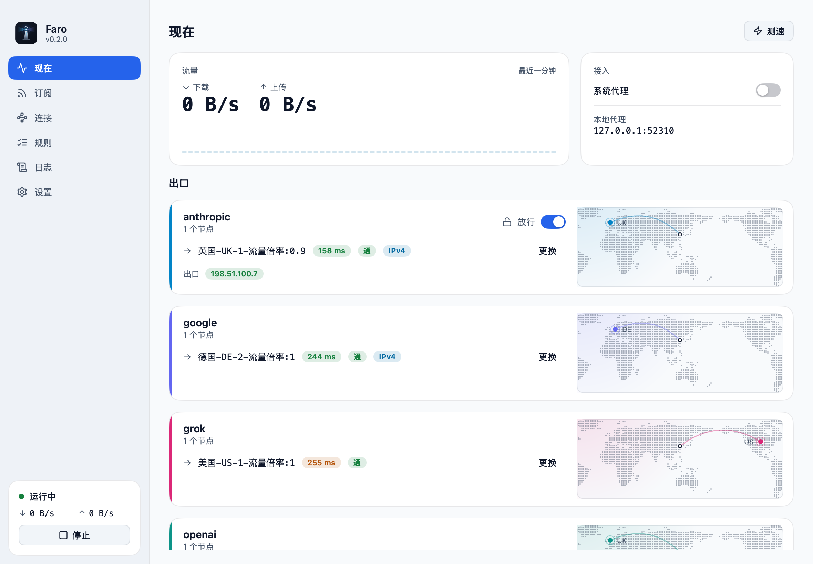
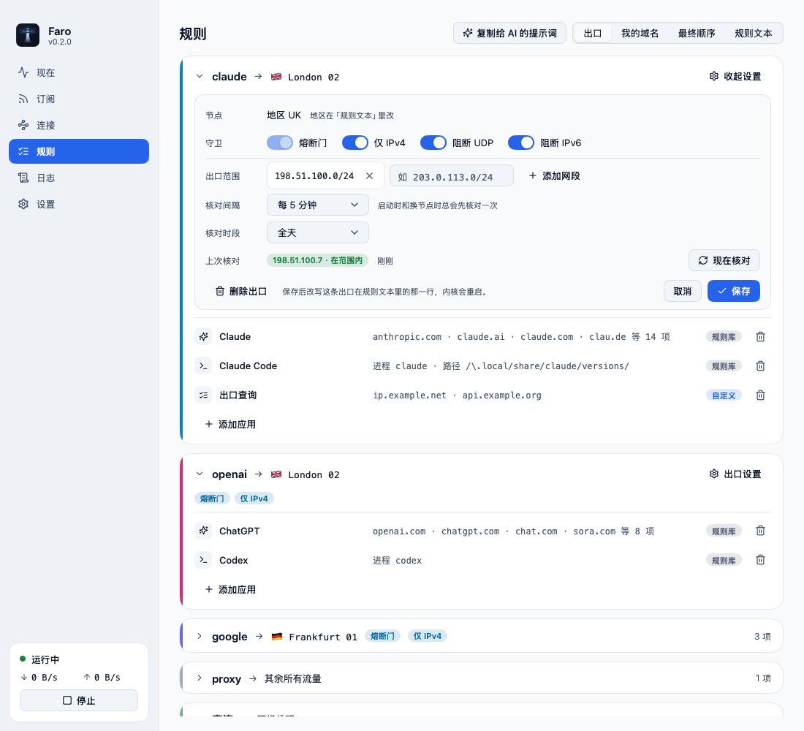
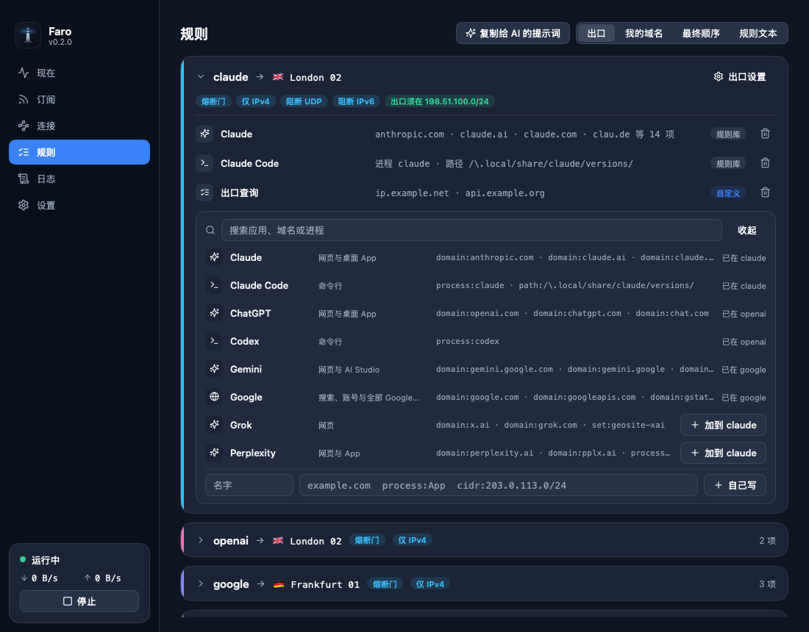
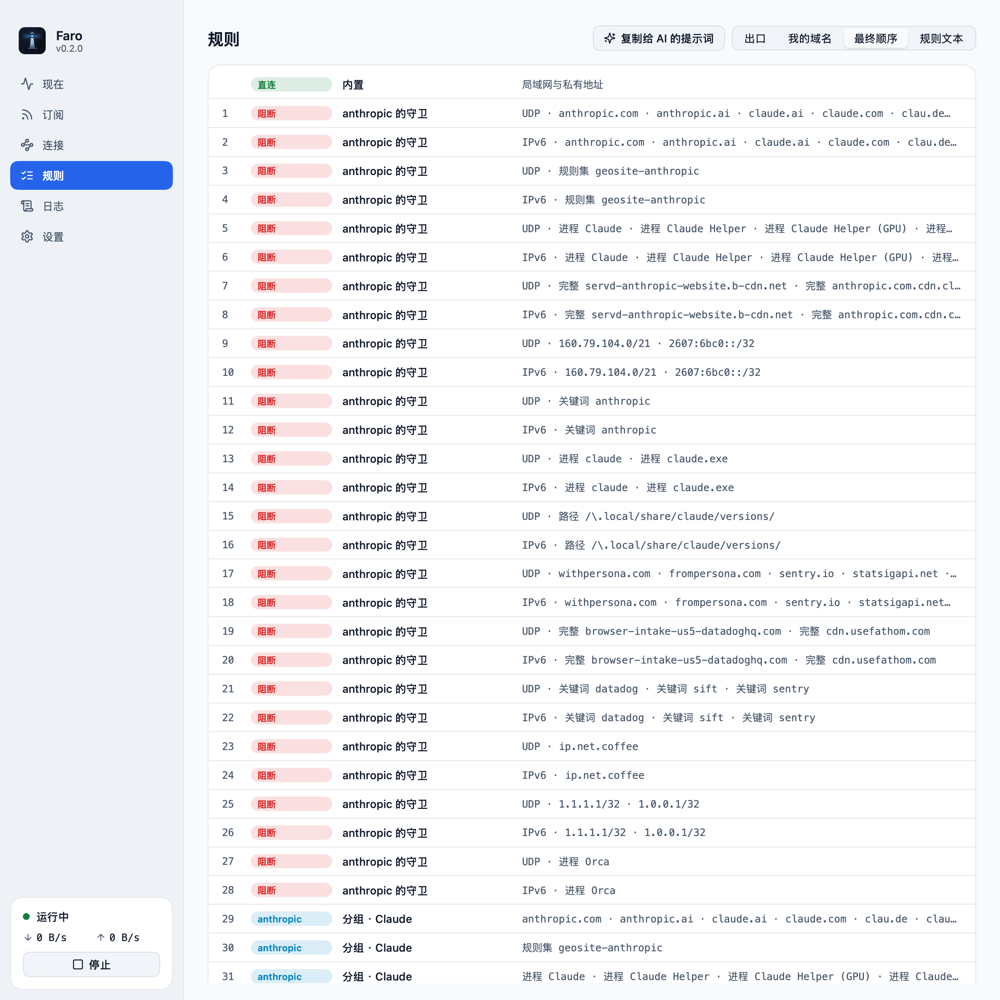

# Faro

**给 AI 账号用的 macOS 代理客户端。** 让 Claude、ChatGPT、Gemini 这类账号始终从同一个、经过核对的出口连出去，不跳国家，不漏 IPv6 和 UDP，出口不对就立刻切断。

[简体中文](README.md) · [English](README.en.md)



## 为什么需要它

AI 服务的账号对「你从哪里连过来」很敏感：今天英国、明天日本、偶尔漏一次国内 IP，都可能让账号被风控。常见的代理客户端是为速度设计的：自动选最快的节点、节点不通就换一个、IPv6 和 QUIC 绕过代理直接出去。这些对看视频是好事，对 AI 账号正好相反。

Faro 反过来设计：**宁可断开，也不换出口。**

- **一个服务，一个出口，固定一个节点。** 出口不会自己切到「更快」的节点，换节点只能你手动换。
- **出口核对。** 给出口写上允许的落地网段（如 `exit:198.51.100.0/24`）。Faro 会定时经由这条出口查询外界看到的 IP，不在范围内就立刻切断，并发通知。启动时、换节点时总会先核对，核对通过前保持切断。
- **熔断门。** 每条出口一个开关，随时切断。切断期间，发往它的流量哪儿也不去。
- **挡住旁路。** 出口打开「阻断 UDP」「阻断 IPv6」后，发往它的每条规则都会在**所有规则之前**生成对应的阻断，QUIC 和 IPv6 不会从别处漏出去。
- **绝不兜底。** 出口没有可用节点、或者应用指向的出口不存在，流量一律**阻断**，绝不落到别的国家的节点上。
- **管住桌面 App 和命令行。** 规则不只看域名，还能看进程和路径。Claude 桌面版、Claude Code、Codex 这类不走浏览器的程序也能管住。
- **只走 IPv4 的出口。** 名字在本机经由这条出口只解析 IPv4，再把地址交给节点，节点没有机会改走 IPv6。
- **DNS 不出卖你。** 国外域名的 DNS 查询经过代理发出，国内域名直接查询；不使用系统的解析器。

## 截图

**出口和它的设置。** 出口卡片可以折叠；节点、守卫、出口网段、核对间隔和时段都写在卡片上，不从别处继承。



**应用规则库。** 搜索 Claude、ChatGPT、Gemini、Cursor、GitHub 等常用服务，一键加到某个出口；也可以自己写域名、进程或 IP 段。



**最终顺序。** 按 sing-box 实际比对的顺序列出每条规则，并标出被上面的规则挡住、永远用不到的部分。



## 其他功能

- **订阅和节点。** 导入订阅链接或本地文件；节点按国家分组、自然排序、名字缩短；点一下节点就测速，红点表示不通。
- **地图。** 每条出口画一条从这台 Mac 到出口所在地的弧线。
- **每条连接都能解释自己。** 选中一条连接，就能看到命中了哪条规则、走了哪条路径。
- **规则文本。** 一门小的规则语言（不是 sing-box 或 Clash 的），报错带行号；平时用不到，属于高级用法。
- **复制给 AI 的提示词。** 一键复制一段说明，里面有规则语法和你现在的出口、应用，贴给任何 AI 让它帮你改规则；Faro 自己不会向任何地方发送内容。
- **社区规则集**（SagerNet 的 sing-geosite / sing-geoip）在后台保持最新。
- **菜单栏**：网速、熔断门、节点；**轻量模式**：只留菜单栏，约 20 MB 内存。

## 上手

1. **订阅**页添加你的订阅链接。
2. **规则 → 出口**里点「新建出口」，比如名字叫 `claude`，节点选「名称匹配」写 `^英国-UK-1-`，打开熔断门、仅 IPv4、阻断 UDP、阻断 IPv6。
3. 打开这条出口的「出口设置」，加上你的落地网段，选核对间隔。
4. 在出口卡片上「添加应用」：从规则库加 Claude、Claude Code；需要的话再自己写。
5. 回到**现在**页，看出口核对是否通过，再打开系统代理。

## 规则语言（高级）

```
route claude region UK gate ipv4 noudp noipv6 exit:198.51.100.0/24 check:5m hours:09:00-23:30
route google regex "^德国-DE-2-" gate ipv4
claude process:"Claude Helper" domain:claude.ai     # 发往 claude 出口
block udp port:443 path:"Some Browser\.app"         # 只限 UDP、几个条件同时满足：应用做不到的写在这里
direct set:geosite-cn                               # 国内直连
```

生效顺序：局域网与私有地址直连 → 各出口生成的阻断 → 应用（按顺序）→ 规则文本（从上往下）→ 其余走 `proxy`。第一条命中的决定去向。完整语法在规则页「复制给 AI 的提示词」里。

## 下载安装

到 [Releases](https://github.com/huangpd/faro/releases) 下载：

- **Apple Silicon**（M1、M2、M3、M4…）：`Faro-<版本>-AppleSilicon.dmg`
- **Intel Mac**：`Faro-<版本>-Intel.dmg`

打开 DMG，把 `faro.app` 拖进「应用程序」。App 没有 Apple 开发者签名，macOS 第一次会拦下它：打开一次，然后到「系统设置 → 隐私与安全性」点 Faro 旁边的「仍要打开」。

> 状态：早期。未做代码签名，暂无 TUN 模式。

## 从源码构建

要求：macOS，Go 1.27 或更新。

```sh
./scripts/fetch-singbox.sh     # 下载固定版本的 sing-box 核心
./scripts/fetch-rulesets.sh    # 下载随应用打包的规则集
go test ./...                  # 用真实的 sing-box 加假节点测试
go run .                       # 从源码运行
./scripts/package.sh           # 构建 build/darwin-<arch>/faro.app 和磁盘镜像
```

两种 Mac 一起构建：`./scripts/fetch-singbox.sh amd64` 下载 Intel 版内核，再 `go tool mygo build -platform darwin/arm64,darwin/amd64`。推送 `v<版本>` 标签时，GitHub Actions 会自动构建这两个版本并发布到 Releases（见 `.github/workflows/release.yml`）。

技术上：原生 GPU 渲染界面（[mygo](https://github.com/egoist/mygo)，没有 WebView，不用 cgo）；[sing-box](https://github.com/SagerNet/sing-box) 作为独立进程运行，通过 Clash API 控制。代码结构：`internal/engine` 是 Faro 做的所有事（不含界面），`internal/rules` 是规则语言，`internal/singcfg` 生成 sing-box 配置，`internal/applib/data/apps.list` 是应用规则库，各页面是根目录下的 `page_*.go`。

## 隐私

除了你让它转发的流量，Faro 只会连接：你添加的订阅链接、规则集镜像（GitHub / jsDelivr）、你选的 DNS 服务器、节点测速地址（`cp.cloudflare.com`），以及出口核对时经由出口本身询问 IP 的服务（Cloudflare trace、ipify、ifconfig.me，依次尝试）。没有遥测，没有账号。所有数据保存在你自己 Mac 上的 `~/Library/Application Support/Faro`。

## 说明

Faro 能让连接方式稳定、可核对，但不能保证任何服务不对你的账号采取措施。请遵守你所在地的法律和各服务的使用条款。

## 许可证

Faro 使用 MIT 许可证（见 [LICENSE](LICENSE)）。sing-box 是独立的程序，有它自己的许可证，由上面的脚本下载、作为独立进程运行；分发包含它的构建前，请先查看 [resources/licenses/NOTICE.txt](resources/licenses/NOTICE.txt)。图标来自 [Lucide](https://lucide.dev)（ISC）。
